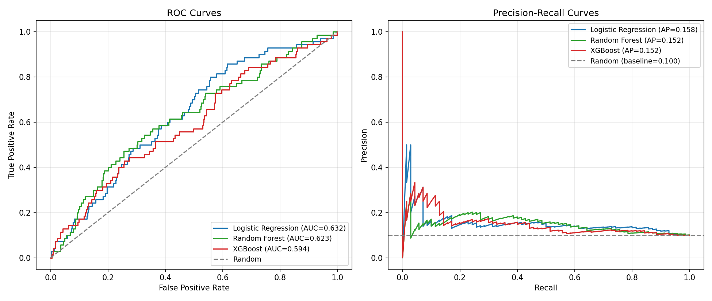
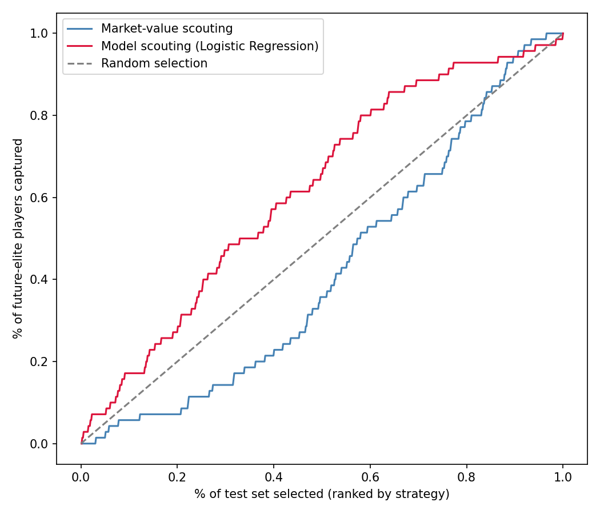
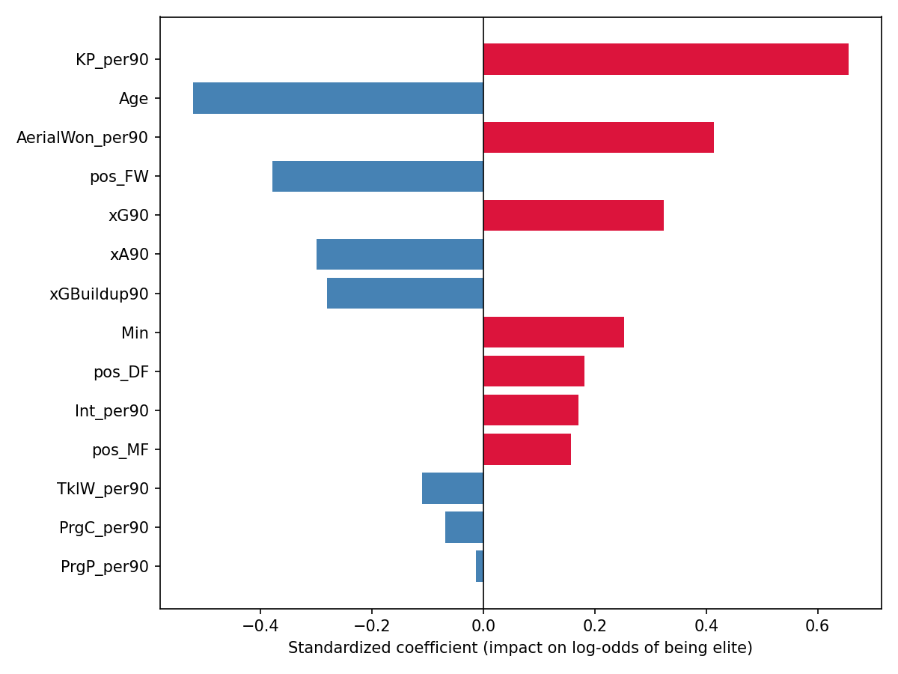
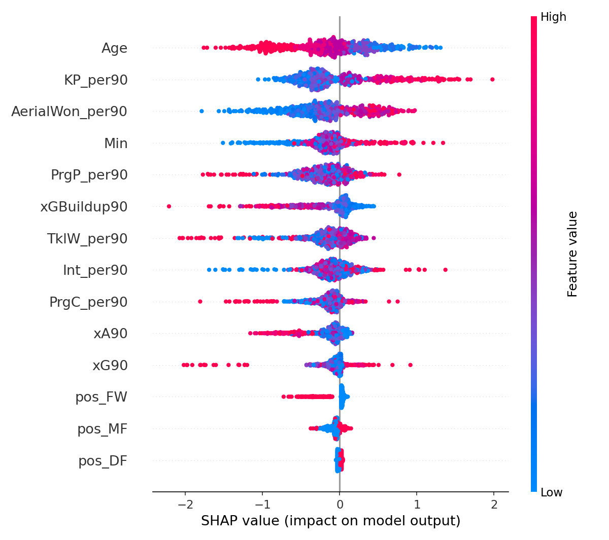

# Spotting Tomorrow’s Stars Today

### Can interpretable machine learning help football clubs identify young players before the wider market does?

This MSc Data Science project explores whether performance data can help identify young footballers who go on to meet a defined **future-elite** outcome. It compares two recruitment approaches:

- **Market-value scouting:** rank players by their current Transfermarkt market value.
- **Model scouting:** rank players by a machine-learning model’s predicted probability of becoming future-elite.

The project focuses on outfield players aged 18–24 in the Big Five European leagues, using player-season observations from 2019–20 to 2023–24.

> **Main result:** In the held-out test set, the model-based shortlist contained 16 future-elite observations in its top 100, compared with 5 for the market-value shortlist.

The results suggest that performance data can add a useful signal to recruitment analysis. They do not show that a model should replace scouts, market information or club-specific judgement.

---

## Results at a glance

### Model performance

| Model | ROC-AUC | PR-AUC (average precision) |
|---|---:|---:|
| Logistic regression | **0.632** | **0.158** |
| Random forest | 0.623 | 0.152 |
| XGBoost | 0.594 | 0.152 |

Logistic regression achieved the strongest ROC-AUC and PR-AUC in the reproduced run, so its predicted probabilities were used for the main model-based recruitment ranking. The evaluation uses a grouped train/test split, keeping each player in only one partition.



### Recruitment shortlist comparison

| Shortlist size | Market-value hits | Model hits |
|---:|---:|---:|
| 10 | 0 | **2** |
| 20 | 0 | **5** |
| 30 | 1 | **5** |
| 50 | 3 | **7** |
| 100 | 5 | **16** |

A “hit” means that an observation in the shortlist has the positive future-elite label defined in this project. The comparison is based on the held-out test set and should be interpreted in the context of that label.



## Research question

**Can interpretable machine learning applied to football performance data identify young players who later become elite before this development is reflected in their market value?**

The project treats recruitment as a player-season prediction problem. Each row represents a player in a particular season, using information available for that observation to predict the later outcome.

## Data and scope

The pipeline combines information from three football data sources:

- **FBref:** player performance and playing-time statistics.
- **Understat:** expected-goals and related performance metrics.
- **Transfermarkt:** player identifiers and market-value observations.

The reproduced modelling dataset contains:

- **2,764 player-season observations**
- **1,471 distinct players**
- **249 positive observations** and 2,515 negative observations
- Big Five European leagues, 2019–20 to 2023–24
- Outfield players aged 18–24, with a minimum of 900 minutes

The original provider datasets are not included in this repository. See [Data access and licensing](#data-access-and-licensing) before attempting to reproduce the pipeline.

## How the future-elite outcome is defined

The label is a project-specific composite, not a universal or official definition of an elite footballer. The construction notebook creates three binary signals:

1. **Market-value growth:** whether the player's two-year value-growth ratio is in the top 20% within their primary position.
2. **Club-tier progression:** whether the player moves to a club in a higher quartile of average squad market value.
3. **Performance breakout:** whether a position-specific performance composite ranks in the top 20%.

A player-season is labelled future-elite when at least **two of the three signals** are met.

The performance composite uses different indicators for forwards, midfielders and defenders; goalkeepers are excluded. The market-value growth threshold is position-relative rather than a fixed multiple. Where future market-value or club-tier comparisons are unavailable, the original implementation does not award a positive flag for that signal. This is an important limitation when interpreting the label.

## Methodology

The workflow is organised into six executed notebooks:

| Notebook | Purpose |
|---|---|
| `01_data_integration.ipynb` | Combines FBref exports and creates the observation-scope dataset. |
| `02_understat_data_collection.ipynb` | Combines the five league-level Understat workbooks. |
| `03_fbref_understat_matching.ipynb` | Matches player-season records across FBref and Understat. |
| `04_transfermarkt_matching_valuation.ipynb` | Adds Transfermarkt identifiers and historical market values. |
| `05_composite_label_construction.ipynb` | Builds the composite future-elite outcome. |
| `07_modelling_and_shap.ipynb` | Trains, evaluates and interprets the prediction models. |

The modelling stage compares logistic regression, random forest and XGBoost. It uses a player-grouped train/test split to reduce the risk of the same player appearing in both sets. Missing feature values are imputed using training-set medians; logistic regression uses standardised features and class weighting.

Evaluation includes ROC-AUC, average precision (PR-AUC), confusion matrices and a top-*K* recruitment comparison. Logistic-regression coefficients provide a directly interpretable view of the primary model. SHAP is included as a secondary interpretation method for XGBoost.





## Repository structure

```text
football-player-development-prediction/
├── README.md
├── requirements.txt
├── .gitignore
├── notebooks/
│   ├── 01_data_integration.ipynb
│   ├── 02_understat_data_collection.ipynb
│   ├── 03_fbref_understat_matching.ipynb
│   ├── 04_transfermarkt_matching_valuation.ipynb
│   ├── 05_composite_label_construction.ipynb
│   └── 07_modelling_and_shap.ipynb
├── data/
│   ├── README.md
│   ├── raw/
│   └── processed/
└── results/
    ├── figures/
    └── tables/
```

The notebooks are saved with their executed outputs. The `data/raw/` and `data/processed/` folders contain placeholders only; the underlying datasets are not bundled.

## Reproducing the project

1. Clone or download this repository.
2. Obtain the required source files independently, where permitted.
3. Read [`data/README.md`](data/README.md) for the expected filenames and folder locations.
4. Install the Python dependencies.
5. Run notebooks `01` to `05` in order, followed by notebook `07`.

From the repository root:

```bash
python -m pip install -r requirements.txt
jupyter notebook
```

Notebook `04` expects the combined FBref–Understat file in `data/processed/` and the Transfermarkt source files in `data/raw/transfermarkt/`. Notebook `05` also reads the Transfermarkt valuation file from that folder. Check the notebook setup cells and `data/README.md` for exact paths before running.

## Pipeline verification

The full workflow was executed locally using the supplied source archives. The main intermediate counts were:

| Stage | Result |
|---|---:|
| Combined FBref exports | 25,768 rows |
| FBref observation-scope sample | 6,231 rows |
| Understat combined dataset | 18,827 rows |
| FBref–Understat matched sample | 2,872 rows |
| Final labelled dataset | 2,764 rows |
| Positive future-elite observations | 249 |

The FBref–Understat matching stage retained 2,654 exact matches and 218 accepted fuzzy matches, giving a 95.5% match rate among the eligible FBref player-season records. The detailed execution record is in [`pipeline_execution_summary.csv`](results/tables/pipeline_execution_summary.csv).

## Limitations

- The positive class is relatively uncommon, and model performance is moderate rather than highly predictive.
- The target is a constructed proxy based on later market-value growth, club progression and performance breakout. It should not be treated as a definitive measure of player quality or potential.
- Missing future valuation or club information can affect the composite label because unavailable comparisons do not receive a positive signal in the original implementation.
- The performance composite and percentile thresholds depend on the study sample and the chosen position groups.
- The main evaluation uses one grouped hold-out split with a fixed random seed, rather than repeated cross-validation.
- Market values are estimates and do not capture every factor involved in recruitment, such as contract length, injuries, tactical fit, personal circumstances or a club’s scouting knowledge.
- The results apply to the selected leagues, seasons, age range, minutes threshold, features and label definition.

## Data access and licensing

This project uses data collected or matched from FBref, Understat and Transfermarkt. The repository does **not** redistribute the underlying source datasets. Before reproducing the pipeline or publishing any derived data, check the relevant providers’ current terms and any applicable restrictions. Users should obtain source data independently and only use it in ways permitted by those terms.

The full university dissertation is not included in this repository. This GitHub project is a code-and-results portfolio version of the work.

## Project status

The six notebooks in the documented workflow have been executed locally and their outputs retained. The portfolio package includes the notebooks, figures, summary tables and setup instructions, but excludes the original datasets pending a review of redistribution permissions.
